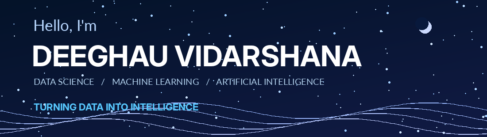
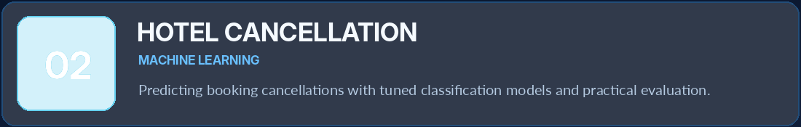
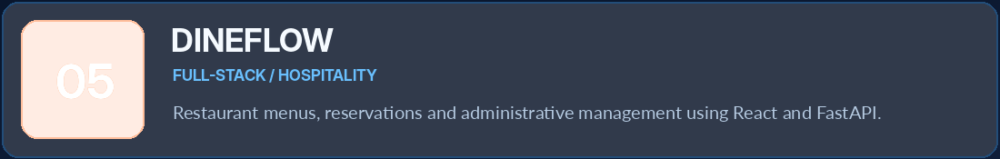

  

<table><tr><td width="72%">

### 👋 Hello!

I'm a **Data Science undergraduate** and **Data Analyst Intern** passionate about transforming messy data into useful intelligence. My interests include **machine learning, AI systems, research, data engineering and practical software development**.

- 🎓 **Specialization:** Data Science
- 💼 **Current role:** Data Analyst Intern
- 🧠 **Exploring:** AI, ML, intelligent systems, research
- 🛠️ **Building:** End-to-end data and software projects
- 🌍 **Based in:** Sri Lanka

</td><td width="28%" align="center">

</td></tr></table>

**Languages & Development**

**Data Science, Machine Learning & Business Intelligence**

    

**Tools & Platforms**

### ✦ Turning data into intelligence, and ideas into impact.

